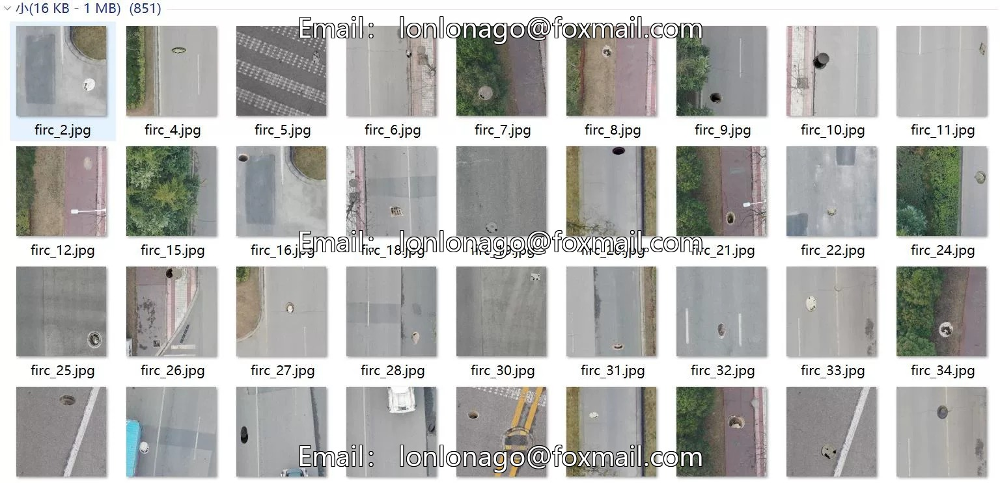
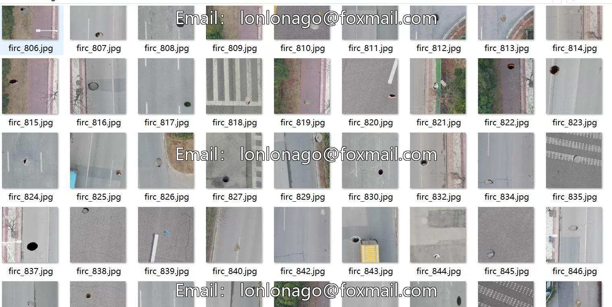
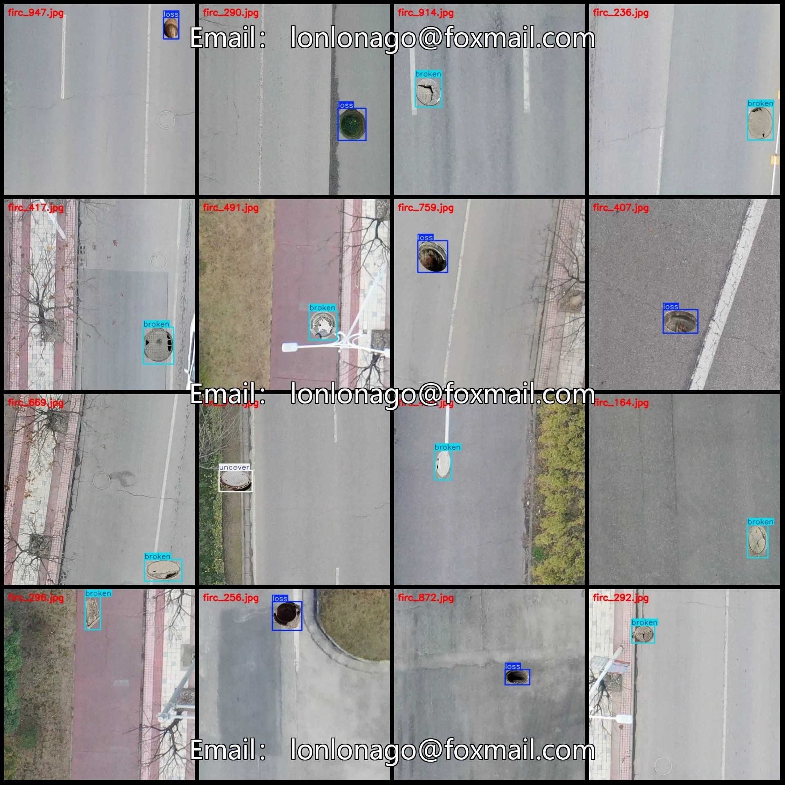
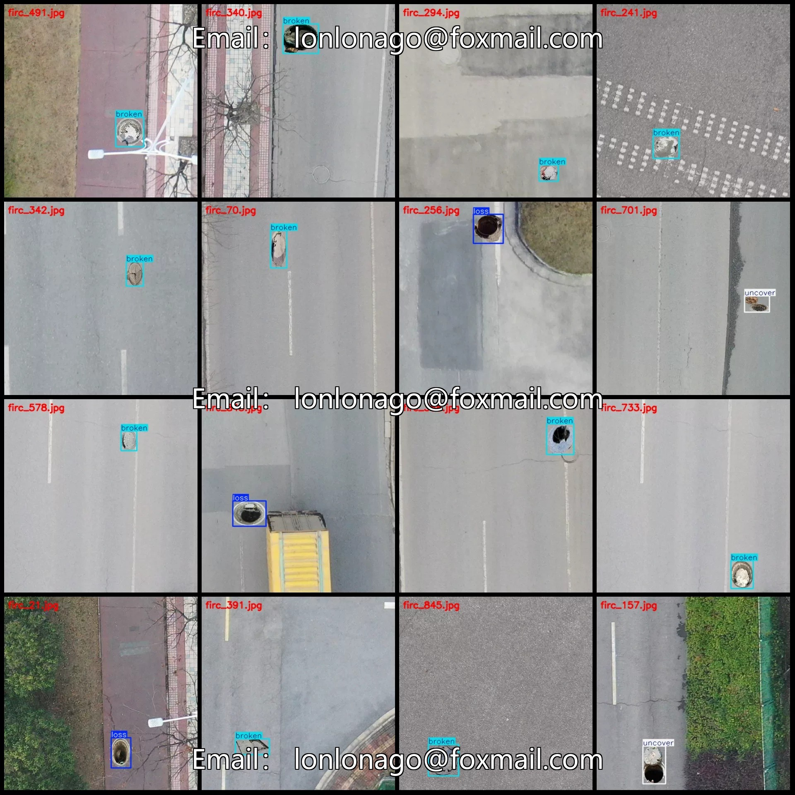

# Drone-view intelligent traffic road surface utility cover abnormal loss, damage, or improperly installed detection dataset V

## Body

Drone-View Smart Traffic Roadway Paving Manhole Abnormal Loss, Damage, or Unsealed Detection Data Set - VOC+YOLO Format - 851 Categories
Warm Reminder: Due to the dataset's replicability, please confirm compliance with requirements before purchasing.
Please note that the dataset consists of synthetic images; specific details are mentioned in the description.
Please be aware that refusal to accept returns due to claims such as "the images are synthetic, the synthesis is too fake" is not accepted.
Dataset format: Pascal VOC format + YOLO format (excluding the segmentation path in the txt file, only including jpg images and corresponding VOC format xml files and yolo format txt files)
Number of images (number of jpg files): 851
Number of annotations (number of xml files): 851

Number of annotations (number of txt files): 851
Number of annotation categories: 3
Annotation category names (note that the order in yolo format does not correspond to this, but refer to the labels folder's classes.txt for reference): ["broken", "loss", "uncover"]
Number of bounding boxes per category
- Broken (Broken Manhole Cover) = 563
- Loss (Lost Manhole Cover) = 193
- Uncover (Uncovered Manhole Cover) = 102
Total bounding boxes = 858
Number of images per category
- Broken = 559
- Loss = 193

Discovered Image Count = 102
Image Resolution: 512x512
Labeling Tool: labelImg
Labeling Rules: Draw a rectangle around the category.
Important Note: The dataset does not have separate training, validation, and test sets; you need to partition them yourself.
Special Remark: This dataset does not guarantee the accuracy of the trained models or weight files.

## Images

## Payment

Here is a pay link on Stripe ( https://buy.stripe.com/3cs8yP7sY87d0vu9AB ). Please contact me lonlonago@foxmail.com after funding $89, and I will send you a complete data files , thank you!

